# Capítulo V: Product Implementation, Validation & Deployment

## 5.1. Software Configuration Management

Para tener consistencia y seguimiento del desarrollo de la plataforma, se definió un conjunto de herramientas y estrategias de trabajo. Esta sección cubre la configuración del entorno de desarrollo, la gestión del código fuente y el despliegue, alineados con las buenas prácticas de ingeniería de software y con los marcos de trabajo ágiles.

### 5.1.1. Software Development Environment Configuration

Con el fin de facilitar la colaboración del equipo en las distintas etapas del ciclo de vida de AgriDron Solutions, se configuró un entorno de desarrollo unificado. Este entorno incluye herramientas estandarizadas para gestión de proyectos, diseño UX/UI, modelado de dominio, codificación, documentación y simulación de APIs, despliegue y control de versiones. La selección responde a criterios de integración con tecnologías open-source (Vue 3 y C# con .NET), soporte para datos geoespaciales y climáticos, y cumplimiento de estándares de la industria.

| Categoría | Herramienta | Propósito | Tipo de acceso / Enlace |
|:--|:--|:--|:--|
| **Project Management** | Jira / Trello | Gestión del backlog, trazabilidad de historias de usuario, y tablero de tareas de cada Sprint bajo Scrum. | [Jira](https://agridron.atlassian.net/jira/software/projects/SCRUM/boards/1/backlog) / [Trello](https://trello.com/invite/b/6aac1a270d8f45bc33ecd592/ATTIbc784176eb8dc497a26da32a3c554ea69211FF0D/agridron) |
| **Requirements Management** | UXPressia | Elaboración de User Personas, Journey Maps, Empathy Maps e Impact Mapping. | [UXPressia](https://uxpressia.com) |
| **Product UX/UI Design** | Figma | Wireframes, wireflows, mock-ups de alta fidelidad y prototipos interactivos. | [Figma](https://www.figma.com) |
| **Modelado de Software** | Structurizr / Miro | Diagramas de arquitectura (C4 Model) y sesiones de EventStorming. | [Structurizr](https://structurizr.com) / [Miro](https://miro.com) |
| **Frontend Development** | WebStorm | Desarrollo de la Web Application en Vue 3 (HTML5, CSS3 y JavaScript). | [WebStorm](https://www.jetbrains.com/webstorm/) |
| **Backend Development** | JetBrains Rider | Desarrollo del RESTful API en C# (.NET) siguiendo Domain-Driven Design. | [JetBrains Rider](https://www.jetbrains.com/rider/) |
| **API Mocking & Documentation** | Apidog | Simulación de endpoints (mock API) y documentación con OpenAPI. | [Apidog](https://apidog.com) |
| **Deployment** | GitHub Pages / Firebase Hosting | Publicación de la Landing Page y de la Web Application. | [GitHub Pages](https://pages.github.com) / [Firebase](https://firebase.google.com/products/hosting) |
| **Version Control** | GitHub | Alojamiento de repositorios y control de versiones mediante GitFlow y Conventional Commits. | [GitHub](https://github.com) |
| **Software Documentation** | Markdown | Redacción del informe del proyecto en formato Docs-as-Code. | Compatible con GitHub |

### 5.1.2. Source Code Management

#### 5.1.2.1. Plataforma y repositorios

El control de versiones del proyecto se realiza en GitHub, dentro de la organización pública AgriDon. Los repositorios son los siguientes:

<div align="center">

| Producto digital | URL del repositorio |
|:--|:--|
| Project Report | https://github.com/AgriDon/AgriDron-report |
| Landing Page | https://github.com/AgriDon/Agridron-LandingPage |
| Frontend Web Application | https://github.com/AgriDon/Agridron-Fronted |
| API simulado (mock) | https://github.com/AgriDon/agridron-mock-api |
| Web Services (Backend API) | https://github.com/AgriDon/Agridron-backend |

</div>

**Modelo de ramificación (GitFlow Workflow)**

Se adopta GitFlow para mantener una separación clara entre el código en desarrollo, las entregas parciales y las versiones estables:

- `main`: contiene el código estable, que es el que se publica.
- `develop`: rama de integración del trabajo en progreso.
- `feature/*`: ramas para cada funcionalidad o bounded context.
  - Convención: `feature/<nombre-descriptivo>`
  - Ejemplos: `feature/fieldManagement`, `feature/reportingContext`, `feature/dashboard-and-settings`
- `release/*`: estabilización y preparación de versiones.
  - Convención: `release/X.Y.Z`
  - Ejemplo: `release/1.0.0`
- `hotfix/*`: correcciones urgentes aplicadas sobre `main`.
  - Convención: `hotfix/X.Y.Z`
  - Ejemplo: `hotfix/1.0.1`

**Versionado semántico**

Las versiones siguen la nomenclatura MAJOR.MINOR.PATCH (Semantic Versioning 2.0.0):

- **MAJOR:** cambios incompatibles en el API o reestructuraciones profundas.
- **MINOR:** nuevas funcionalidades retrocompatibles.
- **PATCH:** correcciones de errores retrocompatibles.
- **Ejemplos:** v1.0.0 (primera versión de la Landing Page), v1.1.0 (primera versión de la Web Application), v1.1.1 (corrección en el visor de mapa).

**Convenciones para commits**

Los mensajes de commit siguen la estructura de Conventional Commits `<type>[optional scope]: <description>`:

- **feat:** nueva funcionalidad.
- **fix:** corrección de un error.
- **docs:** cambios solo en la documentación.
- **style:** formato de código sin cambios de lógica.
- **refactor:** cambios de código que no corrigen errores ni agregan funcionalidades.
- **test:** incorporación o ajuste de pruebas.
- **chore:** tareas de compilación, configuración o dependencias.

Ejemplos de commits del proyecto:

```
feat(reporting): implement analytics and reporting bounded context
fix(flightOperations): resolve i18n translation keys and status badge styles in missions
docs(api): add OpenAPI specification for mock endpoints
```

### 5.1.3. Source Code Style Guide & Conventions

Para velar por la legibilidad, mantenibilidad y calidad del código, el equipo adopta guías de estilo oficiales. Todos los identificadores, variables, nombres de métodos y comentarios del código se redactan en inglés.

**Backend: C# con .NET**

Para el RESTful API se toma como base la guía C# Coding Conventions y las Microsoft ASP.NET Core Coding Guidelines, con una estructura de capas basada en Domain-Driven Design:

- **Estructura de capas:**
  - **Domain:** entidades, agregados, value objects y contratos de repositorios.
  - **Application:** casos de uso, servicios de aplicación, handlers de comandos y consultas, y DTOs.
  - **Infrastructure:** implementación de repositorios (Entity Framework Core), persistencia y clientes HTTP para servicios externos (clima).
  - **API:** controladores RESTful (`[ApiController]`), middlewares de manejo de excepciones y documentación OpenAPI con Swagger.
- **Nomenclatura:**
  - Clases, interfaces, enumeraciones y métodos en PascalCase: `FarmService`, `IParcelRepository`, `MissionStatus`, `CalculateTreatedArea()`.
  - Parámetros y variables locales en camelCase: `plotCoordinates`, `droneId`.
  - Interfaces con prefijo `I`. Constantes en PascalCase.
- **Documentación y anotaciones:**
  - Comentarios XML (`/// <summary>`) en métodos y endpoints públicos.
  - Controladores con atributos de enrutamiento y validaciones (`[HttpGet]`, `[HttpPost]`, `[FromBody]`, `[Required]`).

**Frontend: Vue 3 (JavaScript, HTML5 y CSS3)**

La Web Application y la Landing Page siguen la Vue Style Guide, la Google JavaScript Style Guide, las MDN JavaScript guidelines y la Google HTML/CSS Style Guide:

- **Estructura modular:**
  - Código organizado por bounded contexts (`fieldManagement`, `flightOperations`, `weatherIntegration`, `reporting`) y una capa `shared` para componentes y vistas comunes.
  - Single File Components (`.vue`) que agrupan `<template>`, `<script>` y `<style scoped>`.
- **Nomenclatura:**
  - Archivos de componentes y vistas en kebab-case: `farm-management-view.vue`, `map-polygon-editor.vue`.
  - Nombres de componentes en PascalCase: `FarmManagementView`, `MapPolygonEditor`.
  - Variables, funciones y props en camelCase: `selectedParcelId`, `fetchWeatherForecast()`.
- **HTML y accesibilidad:**
  - Elementos semánticos de HTML5 (`<main>`, `<header>`, `<section>`, `<article>`, `<nav>`).
  - Atributos `alt` en imágenes y atributos `aria-*` para accesibilidad.
- **CSS con nomenclatura BEM (Block Element Modifier):**
  - Clases en kebab-case para evitar colisiones de estilos:
    - Bloque: `.mission-card`
    - Elemento: `.mission-card__status-badge`
    - Modificador: `.mission-card__status-badge--in-progress`
  - Estilos encapsulados con `<style scoped>` en cada componente Vue.

### 5.1.4. Software Deployment Configuration

La configuración de despliegue de AgriDron Solutions establece los procesos, herramientas y entornos para publicar los productos digitales: Landing Page, Web Application y Web Services.

**Despliegue de la Landing Page**

- Tecnología: HTML5, CSS3 y JavaScript, con diseño responsive.
- Repositorio: https://github.com/AgriDon/Agridron-LandingPage
- Plataforma: GitHub Pages.
- Procedimiento:
  - La rama `main` es la fuente de publicación, tomando el directorio raíz (`/`).
  - Los cambios aprobados en `develop` se integran a `main` mediante Pull Requests revisados por el equipo.
  - GitHub Pages actualiza el sitio tras cada integración en `main`.
- URL: https://agridon.github.io/Agridron-LandingPage/

**Despliegue de la Web Application**

- Tecnología: Vue 3 con Vite (JavaScript, HTML5 y CSS3).
- Repositorio: https://github.com/AgriDon/Agridron-Fronted
- Plataforma: Firebase Hosting.
- Procedimiento:
  - Se genera el build de producción con `npm run build`, que produce los archivos estáticos en la carpeta `dist`.
  - Se publica con Firebase CLI mediante `firebase deploy --only hosting`.
  - Firebase Hosting se configura como single-page app, de modo que todas las rutas se redirijan a `index.html`.
  - Las variables de entorno del cliente (como la URL base del API) se definen en archivos `.env`.
  - La automatización del despliegue con GitHub Actions está planificada para los siguientes Sprints.
- URL: https://agridronapp.web.app

**API simulado (mock)**

- Herramienta: Apidog (servicio de mock).
- Repositorio: https://github.com/AgriDon/agridron-mock-api
- La especificación OpenAPI se versiona en el repositorio y la Web Application consume la URL del mock mientras el RESTful API se implementa.

**Despliegue del Backend (Web Services)** *(planificado)*

- Tecnología: C# con .NET (RESTful API).
- Repositorio: https://github.com/AgriDon/Agridron-backend
- Plataforma prevista: Render.
- Las variables sensibles (cadenas de conexión, claves JWT y credenciales del servicio de clima) se gestionarán en la configuración de la plataforma, y el servicio expondrá una URL con HTTPS y CORS restringido a la Web Application.

**Consideraciones generales**

- **Separación de entornos:** los entornos de desarrollo y producción se mantienen aislados mediante archivos de configuración (`appsettings.Development.json` y `appsettings.Production.json` en el backend, y archivos `.env` en el frontend).
- **Pruebas de humo:** después de cada despliegue se verifica manualmente la carga de la aplicación, la navegación entre vistas y el consumo de los endpoints.

## 5.2. Landing Page, Services & Applications Implementation


*Figura: Team Members de la Landing Page con información sobre el equipo de trabajo.*


*Figura: Footer de la Landing Page con información de contacto y redes sociales.*

**Aquí está el enlace a la página desplegada:** https://agridon.github.io/Agridron-LandingPage/

**Enlace del video de ejecucion en youtube:**  https://youtu.be/R6O4g6COh6o

#### 5.2.1.6. Services Documentation Evidence for Sprint Review

Como la Landing Page es una página estática, no fue necesario durante el Sprint el uso de
servicios externos ni conexiones a API's, por lo cual no hay generación ni evidencia de documentación técnica relacionada.

#### 5.2.1.7. Software Deployment Evidence for Sprint Review

La evidencia del despliegue de la Landing Page durante el Sprint se mostrará a continuación, el despliegue se realizará en GitHub Pages.

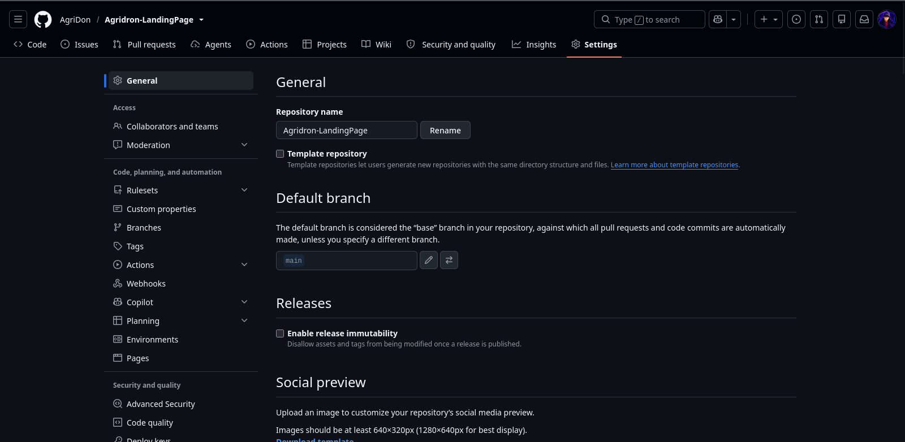

*Nos dirigimos a la seccion de deploy, y selecionamos la rama main:*
*Luego de unos minutos, el deploy se realizara correctamente:*

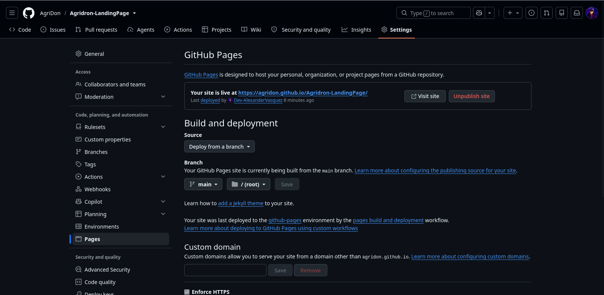

#### 5.2.1.8. Team Collaboration Insights during Sprint

Se anexa evidencia de la participación activa del equipo en el desarrollo de la Landing Page.
Durante el Sprint 1, el equipo utilizó un flujo de trabajo colaborativo mediante Pull Requests y
revisiones de código, asegurando que cada sección cumpliera con los estándares de calidad definidos.
El gráfico de contribuciones muestra una distribución equitativa de tareas entre maquetación, estilos, lógica de i18n y despliegue.

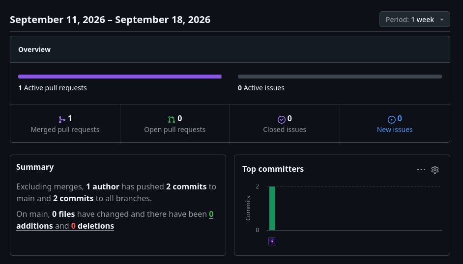

*Reporte de contribuciones y commits del equipo Agridron en el repositorio de la Landing Page*

### 5.2.2. Sprint 2

#### 5.2.2.1. Sprint Planning 2

En el Sprint 2, el equipo se enfocó en el diseño, desarrollo y despliegue de la primera versión de la Web Application de AgriDron Solutions, desarrollada con Vue y PrimeVue bajo el lenguaje de diseño Material Design, y en la actualización de la Landing Page para que sus llamadas a la acción (CTA) redirijan a la vista correspondiente de la Web Application según el segmento.

| Campo | Detalle |
|:--|:--|
| **Sprint #** | Sprint 2 |
| **Fecha** | 26/09/2026 – 09/10/2026 |
| **Hora** | 16:00 hrs |
| **Lugar** | Virtual (Discord / Microsoft Teams) |
| **Preparado por** | Damacen Galindo, Italo Gianfranco; Vasquez Roncal, Alexander Felipe |
| **Asistentes** | Damacen Galindo, Italo Gianfranco; Nicho Huillcañahui, Edwin Noe; Vasquez Roncal, Alexander Felipe; Choquehuanca Vasquez, Alejandro Samir; Jara Espinoza, Miguel Angel |
| **Sprint 1 Review Summary** | La Landing Page quedó desplegada en GitHub Pages con las secciones planificadas (hero, características, planes y precios, preguntas frecuentes, navegación, equipo, galería, métricas de impacto y footer), diseño responsive, soporte multiidioma (ES/EN) y configuración de SEO y accesibilidad. [COMPLETAR: feedback del docente recibido en AV1] |
| **Sprint 1 Retrospective Summary** | Aciertos: uso de ramas feature y Pull Requests hacia `develop` y `main`, y reparto de aspectos entre líderes y colaboradores. Oportunidades de mejora: aplicar Conventional Commits de forma consistente en todos los mensajes y mejorar la estimación de tareas. |
| **Sprint 2 Goal** | Nuestro enfoque está en que agricultores y operadores técnicos puedan acceder a la Web Application desde la Landing Page, gestionar sus fincas y parcelas, y dar seguimiento a las misiones de fumigación, la flota de drones y los reportes. Creemos que esto genera confianza y reduce la coordinación informal por WhatsApp o llamadas. Se confirmará cuando un usuario de prueba pueda recorrer, sin ayuda del equipo, la Landing Page y la Web Application desplegada. |
| **Sprint 2 Velocity** | Límite de 35 SP \| Sumatoria de Story Points: 30 SP |

---

#### 5.2.2.2. Aspect Leaders and Collaborators

Para el Sprint 2 se definieron aspectos asociados a la Web Application y a la actualización de la Landing Page. Cada aspecto tiene un líder (L) responsable de su calidad y colaboradores (C) que apoyan su ejecución. Esta distribución se relaciona con la asignación de tareas del Sprint Backlog 2.

| Team Member | GitHub Username | Authentication & Routing | Field Management (Map) | Mission Request & Weather | Landing Page Update & CTAs | i18n & Accessibility | Deployment |
|:--|:--|:-:|:-:|:-:|:-:|:-:|:-:|
| **Damacen Galindo, Italo Gianfranco** | italodamacen | L | C | C | C | - | C |
| **Nicho Huillcañahui, Edwin Noe** | edwinnicho | C | L | C | - | C | L |
| **Jara Espinoza, Miguel Angel** | MiguelJara | C | C | L | C | C | C |
| **Choquehuanca Vasquez, Alejandro Samir** | SamirChoquehuanca | C | C | C | C | L | - |
| **Vasquez Roncal, Alexander Felipe** | alexandervasquez | - | C | C | L | C | C |

---
#### 5.2.2.3. Sprint Backlog 2

El Sprint Backlog 2 descompone las historias de usuario seleccionadas en tareas técnicas estimadas en horas.
El objetivo principal del sprint es entregar la primera versión desplegada de la Web Application, integrada con la Landing Page.

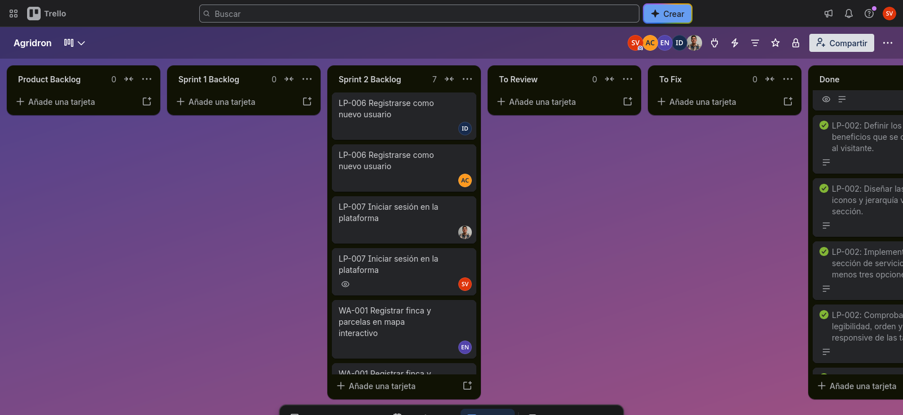

*Figura: Board del Sprint 2 en Trello.*

**URL público del board:** https://trello.com/invite/b/6aac1a270d8f45bc33ecd592/ATTIbc784176eb8dc497a26da32a3c554ea69211FF0D/agridron


| Sprint # | Sprint 2 |
|:--|:--|

| Story Id | Story Title | Task Id | Task Title | Task Description | Estimation (Hours) | Assigned To | Status (To-do / InProcess / ToReview / Done) |
|:--|:--|:--|:--|:--|:-:|:--|:--|
| LP-006 | Registrarse como nuevo usuario | T01 | Crear vista de registro | Construir el formulario de registro con PrimeVue y validaciones de campos. | [6] | [ ] | [Done] |
| LP-006 | Registrarse como nuevo usuario | T02 | Conectar registro con el servicio de autenticación | Enviar los datos del formulario al servicio [local/mock/API] y manejar respuestas de éxito y error. | [5] | [ ] | [Done] |
| LP-007 | Iniciar sesión en la plataforma | T03 | Crear vista de inicio de sesión | Construir el formulario de acceso con mensajes de error accesibles. | [4] | [ ] | [Done] |
| LP-007 | Iniciar sesión en la plataforma | T04 | Configurar rutas protegidas por rol | Configurar Vue Router con guardas de navegación para agricultor, operador y supervisor. | [5] | [ ] | [Done] |
| WA-001 | Registrar finca y parcelas en mapa interactivo | T05 | Integrar biblioteca de mapas | Incorporar la biblioteca de mapas ([Leaflet / otra]) con capa satelital. | [6] | [ ] | [Done] |
| WA-001 | Registrar finca y parcelas en mapa interactivo | T06 | Implementar dibujo de polígonos de parcelas | Permitir delimitar parcelas sobre el mapa y calcular el área en hectáreas. | [10] | [ ] | [Done] |
| WA-001 | Registrar finca y parcelas en mapa interactivo | T07 | Crear formulario y listado de fincas | Registrar nombre, ubicación y cultivo, y listar las fincas del usuario. | [6] | [ ] | [Done] |
| WA-002 | Solicitar misión con validación de riesgos | T08 | Crear formulario de solicitud de misión | Seleccionar parcela, cultivo y fecha para solicitar el servicio. | [6] | [ ] | [Done] |
| WA-002 | Solicitar misión con validación de riesgos | T09 | Mostrar validación de riesgo climático | Presentar la condición del clima antes de confirmar la solicitud. | [4] | [ ] | [Done] |
| TU-003 | Integración con Weather API | T10 | Consumir servicio externo de clima | Implementar el cliente del servicio externo ([nombre de la API]) y manejar errores de conexión. | [6] | [ ] | [Done] |
| WA-003 | Consultar historial y estados | T11 | Crear vista de historial de misiones | Listar misiones con su estado y filtros básicos. | [5] | [ ] | [Done] |
| WA-005 | Gestionar agenda de órdenes | T12 | Crear vista de agenda del operador | Mostrar las órdenes asignadas en calendario junto con la parcela. | [6] | [ ] | [Done] |
| — | Tarea general (Landing Page) | T13 | Actualizar CTAs por segmento | Redirigir cada CTA de la Landing Page a la vista correspondiente de la Web Application. | [4] | [ ] | [Done] |
| — | Tarea general (i18n y a11y) | T14 | Implementar i18n y atributos ARIA en la Web Application | Soportar inglés (en_US, por defecto) y español latinoamericano (es_419), y configurar ARIA. | [8] | [ ] | [Done] |
| — | Tarea general (Despliegue) | T15 | Desplegar la Web Application | Configurar el despliegue desde el repositorio y publicar la primera versión. | [5] | [ ] | [Done] |
 
---

#### 5.2.2.4. Development Evidence for Sprint Review

Durante el Sprint 2 el equipo avanzó en la implementación de la Web Application y en la actualización de la Landing Page de AgriDron Solutions. En la Web Application (Vue 3 con Vite) se estructuró el proyecto, se implementaron los bounded contexts Field Management, Weather Integration, Flight Operations y Analytics & Reporting, y se construyeron las vistas del dashboard y de configuración alineadas con los mock-ups. En paralelo se refactorizó la organización del código para seguir las convenciones de Domain-Driven Design. En la Landing Page se mejoró el diseño responsive y se incorporó el selector de idioma (i18n).

El trabajo se organizó con GitFlow: cada bounded context o funcionalidad se desarrolló en su rama `feature/*` y se integró en `develop` mediante Pull Requests o merges. Las tablas siguientes listan los commits del Sprint 2 por repositorio.

##### Repositorio: Web Application

| Repository | Branch | Commit Id | Commit Message | Commit Message Body | Commited on (Date) |
|:--|:--|:--|:--|:--|:-:|
| AgriDon/Agridron-Fronted | develop | f426ac7 | initialize project structure with Vue 3, Vite, and basic layout components | Inicialización del proyecto con Vue 3 y Vite, y componentes base del layout. | 03/10/2026 |
| AgriDon/Agridron-Fronted | develop | eea89a3 | refactor: remove TypeScript support and update script setup in Vue components | Se elimina TypeScript y se actualiza el uso de script setup en los componentes Vue para trabajar con JavaScript. | 03/10/2026 |
| AgriDon/Agridron-Fronted | feature/fieldManagement | 914f310 | docs: resolver conflicto en README.md al fusionar develop | Resolución del conflicto en el README al integrar develop en la rama de la funcionalidad. | 06/10/2026 |
| AgriDon/Agridron-Fronted | feature/fieldManagement | e6070f3 | bounded contex 2 field management | Implementación del bounded context Field Management (fincas y parcelas). | 06/10/2026 |
| AgriDon/Agridron-Fronted | develop | 9faa7f4 | Merge pull request #1 from AgriDon/feature/fieldManagement | Integración de Field Management en develop mediante Pull Request #1. | 06/10/2026 |
| AgriDon/Agridron-Fronted | feature/weatherIntegration | 1dde398 | feat(weatherIntegration): migrate weatherIntegration bounded context from Angular to Vue | Migración del bounded context Weather Integration a Vue. | 07/10/2026 |
| AgriDon/Agridron-Fronted | feature/flightOperations | 401c3b2 | add: flightOpe | Primera versión del bounded context Flight Operations. | 07/10/2026 |
| AgriDon/Agridron-Fronted | feature/flightOperations | 2fea35d | add: comments | Comentarios de documentación en el código de Flight Operations. | 07/10/2026 |
| AgriDon/Agridron-Fronted | feature/fieldManagement | 4a18e03 | Merge remote-tracking branch 'origin/feature/flightOperations' into feature/fieldManagement | Integración de Flight Operations en la rama de Field Management. | 07/10/2026 |
| AgriDon/Agridron-Fronted | feature/fieldManagement | 18f17f6 | se agregaron bounded contex feature/weatherIntegration and feature/flightOperations | Se incorporan los bounded contexts Weather Integration y Flight Operations a la rama de Field Management. | 07/10/2026 |
| AgriDon/Agridron-Fronted | develop | e989dff | Merge pull request #2 from AgriDon/feature/fieldManagement | Integración de los tres bounded contexts en develop mediante Pull Request #2. | 07/10/2026 |
| AgriDon/Agridron-Fronted | develop | e0f9ad0 | feat(db): add new crop treatment entry and update server script | Nuevo registro de tratamiento de cultivo en los datos de prueba y actualización del script del servidor. | 08/10/2026 |
| AgriDon/Agridron-Fronted | develop | 6145836 | fix(flightOperations): resolve i18n translation keys and status badge styles in missions | Corrección de claves de traducción y estilos de las etiquetas de estado en misiones. | 08/10/2026 |
| AgriDon/Agridron-Fronted | develop | 11208cd | refactor(architecture): align fieldManagement, flightOperations, and weather integration with DDD principles | Reorganización de los tres bounded contexts según las convenciones de DDD. | 08/10/2026 |
| AgriDon/Agridron-Fronted | develop | aa3efae | fix(primevue): bypass license verification and suppress invalid license watermark | [Completar con el detalle real del cambio.] | 08/10/2026 |
| AgriDon/Agridron-Fronted | feature/reportingContext | f91dea6 | feat(reporting): implement analytics and reporting bounded context (BC5) | Implementación del bounded context Analytics & Reporting. | 08/10/2026 |
| AgriDon/Agridron-Fronted | develop | 9235c48 | Merge branch 'feature/reportingContext' into develop | Integración de Analytics & Reporting en develop. | 08/10/2026 |
| AgriDon/Agridron-Fronted | develop | 3c8b7dc | feat(flightOperations): integrate drone fleet management from FlightOperations branch | Integración de la gestión de la flota de drones en Flight Operations. | 09/10/2026 |
| AgriDon/Agridron-Fronted | develop | f007a56 | refactor(flightOperations): align architecture with DDD conventions | Reorganización de Flight Operations según las convenciones de DDD. | 09/10/2026 |
| AgriDon/Agridron-Fronted | feature/dashboard-and-settings | be3e9fb | refactor(shared): move layout component to shared presentation layer | El componente de layout pasa a la capa de presentación compartida. | 09/10/2026 |
| AgriDon/Agridron-Fronted | feature/dashboard-and-settings | ea80eb2 | feat(shared): implement dashboard home and settings views matching mockups | Vistas de inicio (dashboard) y configuración según los mock-ups del capítulo IV. | 09/10/2026 |
| AgriDon/Agridron-Fronted | feature/dashboard-and-settings | b5a66f0 | fix(ui): improve home KPI image reliability and synchronize user profile with layout header | Mejora de la carga de imágenes de los KPI y sincronización del perfil de usuario con la cabecera del layout. | 09/10/2026 |
| AgriDon/Agridron-Fronted | develop | 8430748 | Merge branch 'feature/dashboard-and-settings' into develop | Integración del dashboard y configuración en develop. | 09/10/2026 |

##### Repositorio: Landing Page

| Repository | Branch | Commit Id | Commit Message | Commit Message Body | Commited on (Date) |
|:--|:--|:--|:--|:--|:-:|
| AgriDon/Agridron-LandingPage | develop | f9a0fe6 | add: Improvements to responsive desing | Mejoras del diseño responsive para dispositivos móviles y de escritorio. | 07/10/2026 |
| AgriDon/Agridron-LandingPage | main | 4ec863a | Merge pull request #2 from AgriDon/develop | Publicación de las mejoras responsive mediante Pull Request #2. | 07/10/2026 |
| AgriDon/Agridron-LandingPage | develop | b5d4852 | add: translator | Selector de idioma para la internacionalización (inglés y español). | 07/10/2026 |
| AgriDon/Agridron-LandingPage | main | a703f2a | Merge pull request #3 from AgriDon/develop | Publicación del selector de idioma mediante Pull Request #3. | 07/10/2026 |

*Nota: los commits del 18/09/2026 de ambos repositorios (Initial commit y primera versión de la Landing Page) pertenecen al Sprint 1 y se presentan en la sección 5.2.1.4.*
 
---

#### 5.2.2.5. Execution Evidence for Sprint Review

En el Sprint 2 se logró la primera versión funcional de la Web Application de AgriDron Solutions, desarrollada con Vue 3 y PrimeVue, junto con la actualización de la Landing Page. La Web Application integra los bounded contexts Field Management, Weather Integration, Flight Operations y Analytics & Reporting, además de un layout compartido con las vistas de inicio (dashboard) y configuración, construidas según los mock-ups definidos en el capítulo IV. La interfaz se adapta a distintos tamaños de pantalla y soporta cambio de idioma entre inglés y español.

Se utilizó un API simulado (mock) para validar los flujos de gestión de fincas y parcelas, misiones, flota de drones y analítica sin depender del RESTful API en desarrollo. A continuación se presentan las principales vistas implementadas durante el Sprint, junto con una explicación de lo que permite hacer cada una.

##### Landing Page

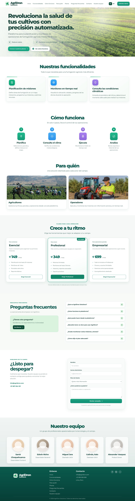

*Figura: Landing Page en su versión de escritorio.*


*Figura: Landing Page en su versión móvil.*

En este Sprint se mejoró el diseño de la Landing Page para que las secciones se reorganicen correctamente en pantallas pequeñas, manteniendo la legibilidad y el tamaño adecuado de los elementos interactivos.


*Figura: Selector de idioma (inglés / español) y botón de demostración en la Landing Page.*

Se incorporó el selector de idioma, que permite al visitante alternar entre inglés (idioma por defecto) y español latinoamericano, como parte del enfoque de internacionalización del producto. Además, un botón permite acceder a una demostración del sistema.

##### Web Application

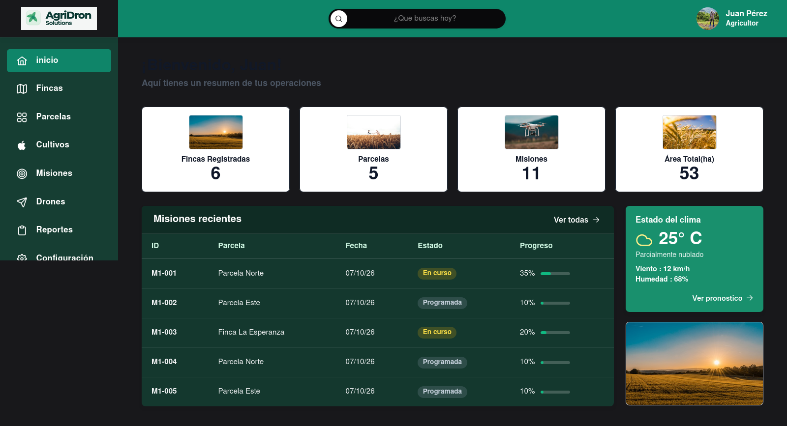

*Figura: Vista de inicio (dashboard) con indicadores clave (KPI).*

La vista de inicio presenta un resumen de la operación mediante indicadores clave (KPI), de modo que el usuario identifique rápidamente el estado general de sus fincas y misiones al ingresar. El perfil del usuario se muestra sincronizado con la cabecera del layout.

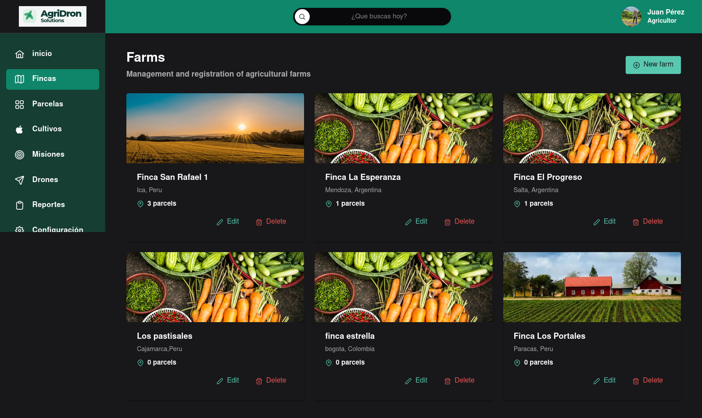

*Figura: Vista de gestión de fincas y parcelas (Field Management).*

Esta vista permite registrar y consultar las fincas y parcelas del agricultor, que son la base para solicitar misiones de fumigación.

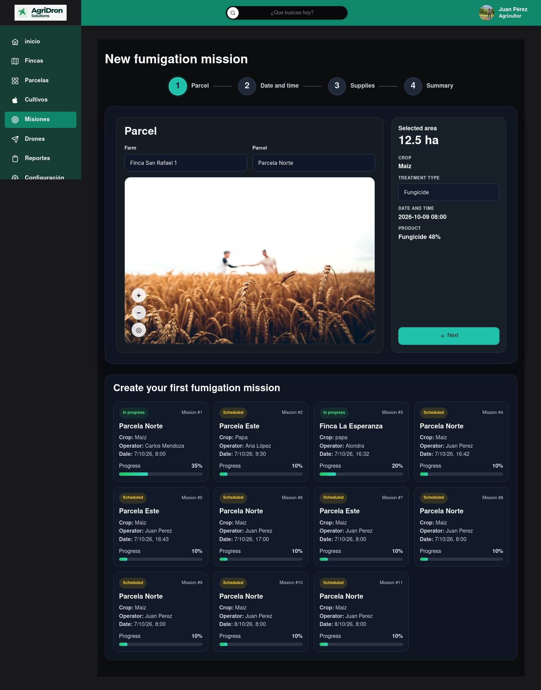

*Figura: Listado de misiones con etiquetas de estado (Flight Operations).*

El listado de misiones muestra cada misión con una etiqueta de estado, lo que facilita el seguimiento de las operaciones. Los textos de la vista se traducen según el idioma seleccionado.

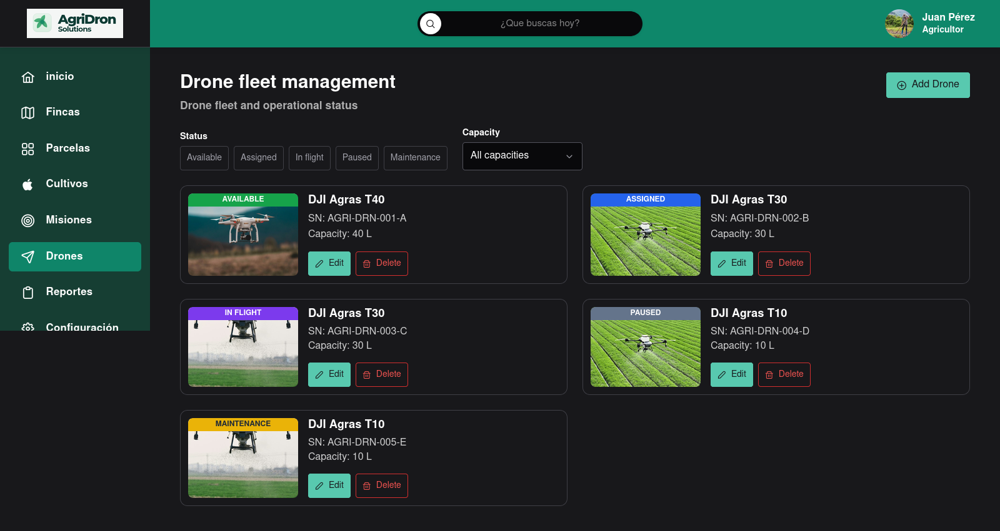

*Figura: Vista de gestión de la flota de drones.*

Esta vista permite consultar los drones disponibles y su estado, información que apoya la asignación de misiones a los operadores.

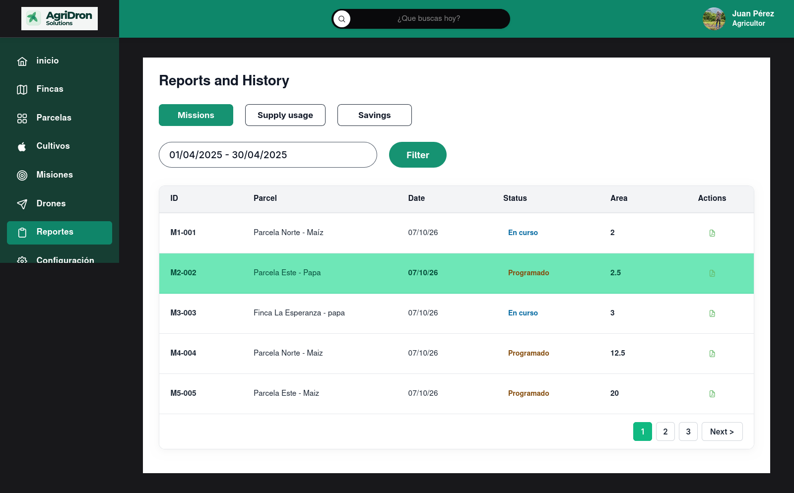

*Figura: Vista de analítica y reportes (Analytics & Reporting).*

La vista de analítica consolida información histórica de las operaciones y de los tratamientos aplicados, y apoya la toma de decisiones del agricultor y del supervisor.

##### Enlaces

**Web Application desplegada:** https://agridronapp.web.app

**Landing Page desplegada:** https://agridon.github.io/Agridron-LandingPage/

**Video de ejecución:** [COMPLETAR: URL del video (YouTube o Microsoft Stream) y duración]

---

    "location": "Cañete",
    "temperature": 24.5,
    "humidity": 68,
    "windSpeed": 12.3,
    "precipitation": 0,
    "observedAt": "2026-10-02T08:00:00",
    "alerts": []
}
]
```
 
`GET /drones` devuelve la flota de drones con su estado, nivel de batería y fechas de mantenimiento:
 
```json
[
  {
    "id": 1,
    "serialNumber": "AGRI-DRN-001-A",
    "model": "DJI Agras T40",
    "capacity": 40,
    "status": "AVAILABLE",
    "batteryLevel": 80,
    "nozzleId": 1,
    "lastMaintenanceDate": "2026-08-10",
    "nextMaintenanceDate": "2026-11-10"
  }
]
```

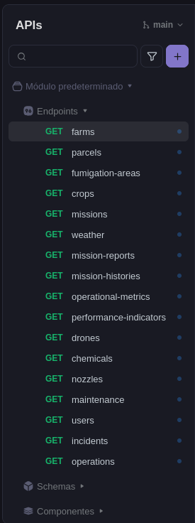

Figura: Lista de endpoints documentados en Apidog.

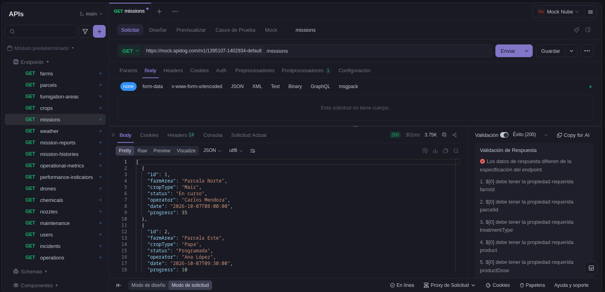

Figura: Prueba del endpoint GET /missions con datos de muestra en Apidog.

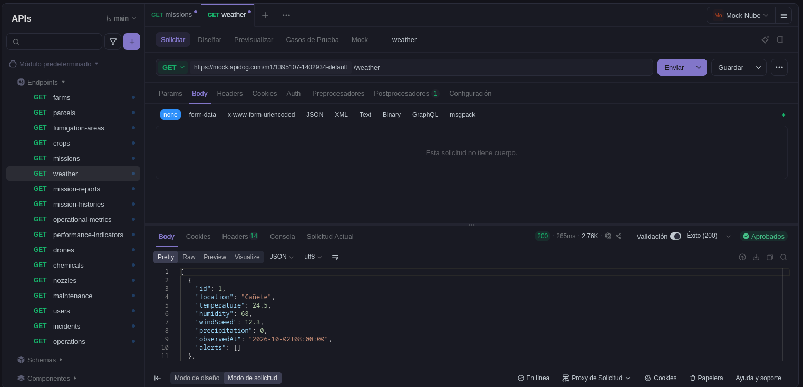

Figura: Prueba del endpoint GET /weather con datos de muestra en Apidog.

Repositorio de Web Services: https://github.com/AgriDon/agridron-mock-api/tree/develop

Commits relacionados con documentación: 5125fde

#### 5.2.2.7. Software Deployment Evidence for Sprint Review

Durante el Sprint 2 se realizaron actividades de despliegue para los tres productos de la solución. Se publicó la primera versión de la Web Application en Firebase Hosting, se volvió a desplegar la Landing Page con las mejoras de diseño responsive y el selector de idioma, y se dejó disponible el API simulado que consume la Web Application mientras el RESTful API en ASP.NET Core se encuentra en desarrollo.

| Producto | Plataforma | URL desplegada | Repositorio |
|:--|:--|:--|:--|
| Landing Page | GitHub Pages | https://agridon.github.io/Agridron-LandingPage/ | https://github.com/AgriDon/Agridron-LandingPage |
| Web Application | Firebase Hosting | https://agridronapp.web.app | https://github.com/AgriDon/Agridron-Fronted |
| API simulado (mock) | Apidog | https://mock.apidog.com/m1/1395107-1402934-default | https://github.com/AgriDon/agridron-mock-api |

##### Landing Page

La Landing Page se publica desde la rama `main` de su repositorio con GitHub Pages. En este Sprint, las mejoras de diseño responsive y el selector de idioma se integraron en `develop` y se publicaron mediante los Pull Requests #2 y #3 hacia `main` (07/10/2026), lo que activó un nuevo despliegue.

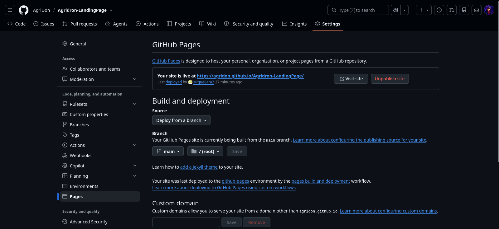

*Figura: Despliegue de la Landing Page en GitHub Pages.*

##### Web Application

La Web Application se desplegó en Firebase Hosting, que sirve la aplicación compilada de Vue como un sitio estático con HTTPS. Pasos realizados:

1. **Creación del proyecto en Firebase.** Desde la consola de Firebase se creó el proyecto AgridronApp y se habilitó el servicio Firebase Hosting.

   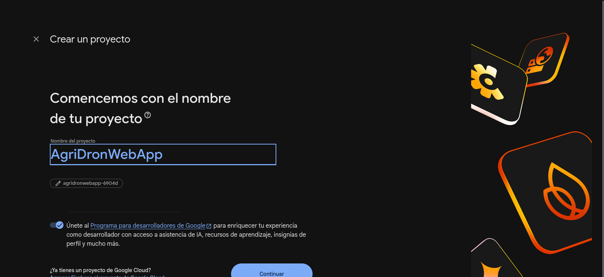

   *Figura: Creación del proyecto en la consola de Firebase.*

2. **Instalación de Firebase CLI e inicio de sesión.** Se instaló la herramienta con `npm install -g firebase-tools` y se inició sesión con `firebase login`.

   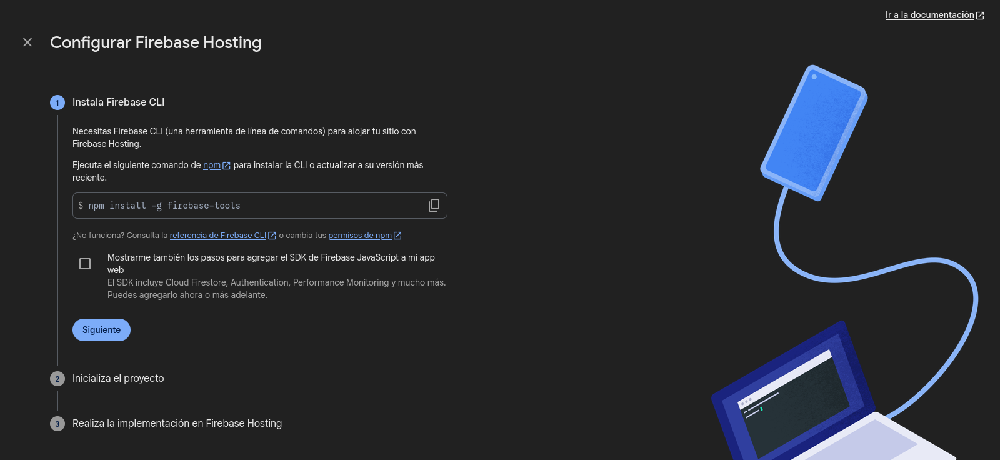

   *Figura: Instalación de Firebase CLI e inicio de sesión.*

3. **Inicialización de Hosting.** Dentro del repositorio `Agridron-Fronted` se ejecutó `firebase init hosting`. Se seleccionó el proyecto creado, se indicó `dist` como directorio público y se configuró la aplicación como single-page app, de modo que todas las rutas se redirijan a `index.html` y la navegación entre vistas funcione al recargar la página.

   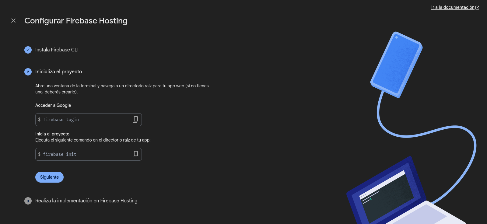

   *Figura: Inicialización de Firebase Hosting en el repositorio.*

4. **Build y despliegue.** Se generó el build de producción con `npm run build` y se publicó con `firebase deploy --only hosting`, que devolvió la URL de Hosting. Se verificó que la aplicación cargara en esa URL, incluyendo la navegación entre vistas.

   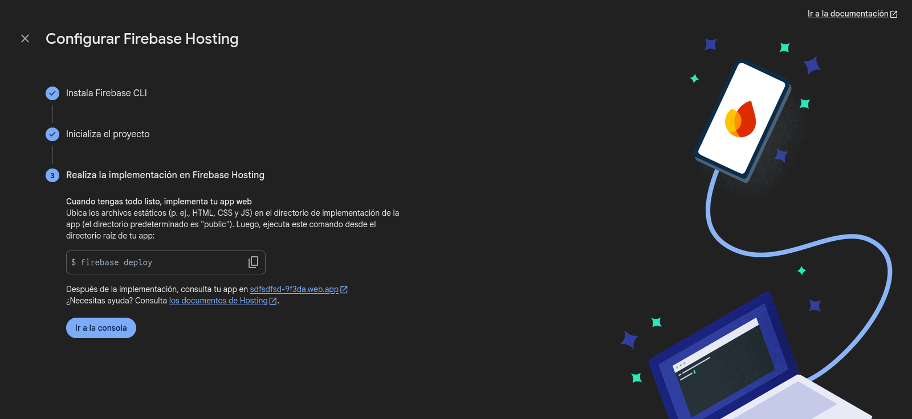

   *Figura: Despliegue completado y aplicación disponible en Firebase Hosting.*

##### API simulado

Los endpoints simulados se publican mediante el servicio de mock de Apidog, cuya URL base es https://mock.apidog.com/m1/1395107-1402934-default. La Web Application consume esa URL, y la especificación OpenAPI se versiona en el repositorio `agridron-mock-api`.

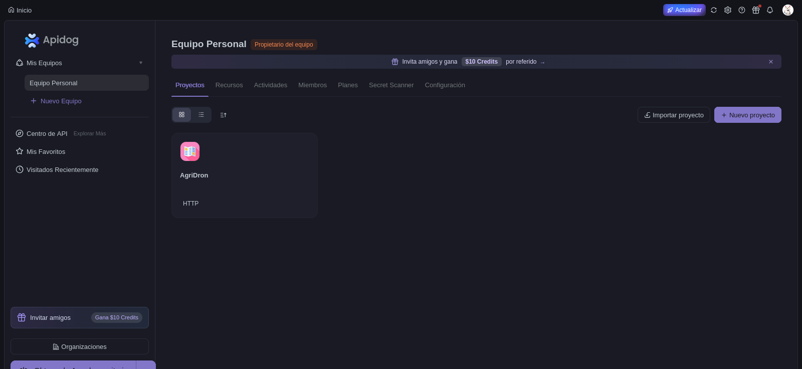

*Figura: Configuración del API simulado en Apidog.*

##### Integración con el flujo de trabajo

El despliegue de la Landing Page es automático: cada integración en `main` actualiza GitHub Pages. La Web Application se publica con Firebase CLI después de integrar los cambios en el repositorio; la automatización de este paso con GitHub Actions está planificada para los siguientes Sprints. [COMPLETAR: confirmar la rama desde la que se despliega la Web Application]

---

#### 5.2.2.8. Team Collaboration Insights during Sprint

Durante el Sprint 2, el equipo desarrolló las actividades de implementación en tres repositorios de la organización AgriDron en GitHub: la Web Application (`Agridron-Fronted`), la Landing Page (`Agridron-LandingPage`) y el API simulado (`agridron-mock-api`). El trabajo se organizó con GitFlow: cada bounded context o funcionalidad se desarrolló en una rama `feature/*` y se integró en `develop` mediante Pull Requests o merges, y las versiones estables de la Landing Page se publicaron desde `main`. Se adoptó Conventional Commits; algunos mensajes de este Sprint no siguen la convención, por lo que se reforzará su aplicación en el siguiente Sprint.

##### Contribución por integrante

| Integrante | Repositorio | Aporte principal en el Sprint 2 | Commits |
|:--|:--|:--|:-:|
| Damacen Galindo, Italo Gianfranco | https://github.com/AgriDon/Agridron-Fronted/tree/develop | bounded context Flight Operations | 937C310 |
| Nicho Huillcañahui, Edwin Noe | https://github.com/AgriDon/Agridron-LandingPage/tree/develop | despliegue en Firebase Hosting y configuración del proyecto | 977K250 |
| Jara Espinoza, Miguel Angel | https://github.com/AgriDon/agridron-mock-api/tree/develop | especificación OpenAPI y API simulado | 837A410 |
| Choquehuanca Vasquez, Alejandro Samir | https://github.com/AgriDon/Agridron-Fronted/tree/develop | internacionalización y accesibilidad | 867K750 |
| Vasquez Roncal, Alexander Felipe | https://github.com/AgriDon/Agridron-LandingPage/tree/develop | Landing Page responsive y vistas de dashboard | 356C250 |

##### Web Application

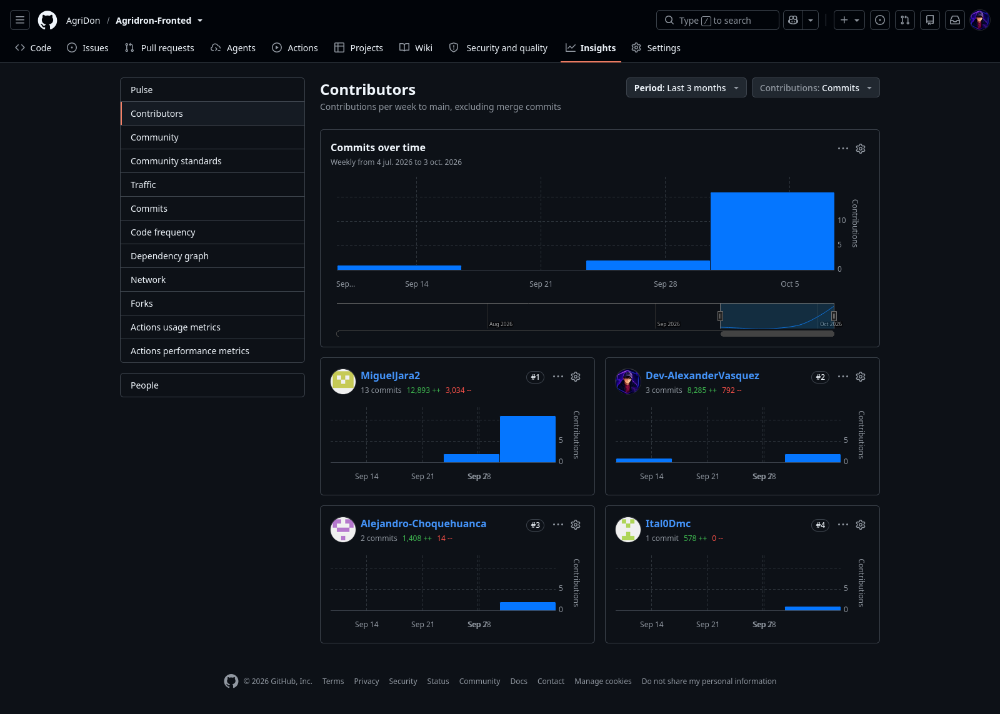

*Figura: Contribuciones de los integrantes en el repositorio de la Web Application durante el Sprint 2.*

##### Landing Page

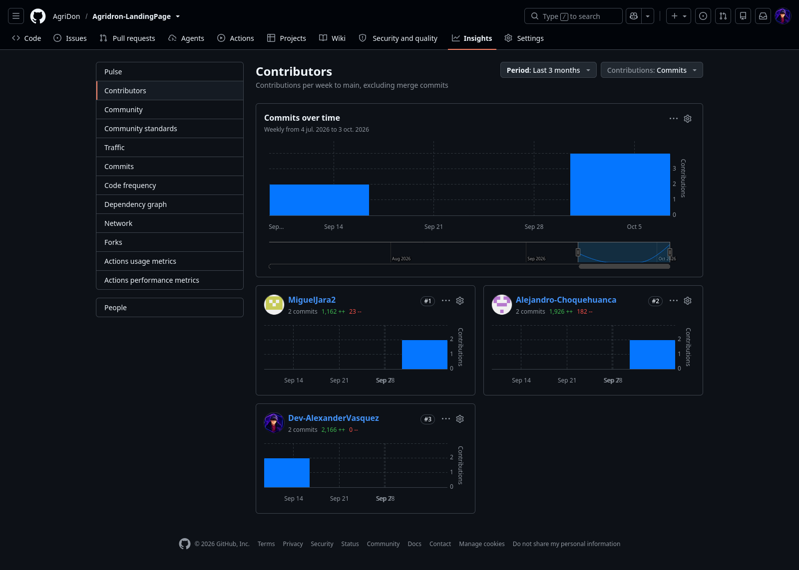

*Figura: Contribuciones de los integrantes en el repositorio de la Landing Page durante el Sprint 2.*

##### API simulado

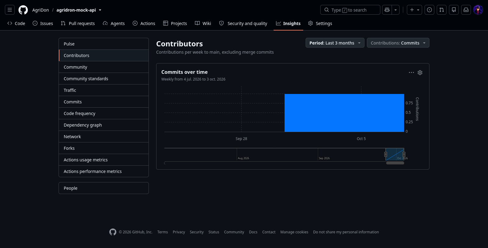

*Figura: Contribuciones de los integrantes en el repositorio del API simulado durante el Sprint 2.*


### 5.2.3. Sprint 3

#### 5.2.3.1. Sprint Planning 3

Durante el Sprint 3, el equipo concentró sus esfuerzos en la materialización de la arquitectura Domain-Driven Design (DDD) y Command Query Responsibility Segregation (CQRS) en el backend desarrollado con ASP.NET Core 10, su despliegue contenerizado en la nube (Render) con persistencia en MySQL (Filess.io), la implementación de un Database Seeder automatizado, y la integración completa con la Web Application en Vue 3 y PrimeVue previamente desplegada en la nube, incorporando internacionalización (i18n), notificaciones ToastService y telemetría de misiones en tiempo real.

| Campo | Detalle |
|:--|:--|
| **Sprint #** | Sprint 3 (AV2 – Semana 12) |
| **Sprint Goal** | Lograr la integración funcional y operativa de los bounded contexts Field Management y Flight Operations mediante el despliegue de una API RESTful en ASP.NET Core 10 contenerizada en Docker sobre Render con persistencia en MySQL en la nube, y su consumo por parte de la aplicación web Vue 3 desplegada en producción, garantizando la delimitación parcelaria en formato GeoJSON, la administración de la flota de drones agrícolas y la orquestación del ciclo de vida de las misiones de fumigación con supervisión telemétrica. |
| **Duración** | 2 semanas (del 28/10/2026 al 12/11/2026) |
| **Velocity estimada** | 48 Story Points |
| **Story Points completados** | 48 Story Points |
| **Historias de Usuario** | US11, US12, US13, US14, US15, US16, US17, US18 |
| **Total de Engineering Tasks** | 20 tareas técnicas |
| **Total de horas hombre estimadas** | 120 horas |

#### 5.2.3.2. Aspect Leaders and Collaborators

Para el Sprint 3 se definieron aspectos técnicos multidisciplinarios que abarcan el backend en ASP.NET Core 10, la infraestructura en la nube, el frontend en Vue 3 y los artefactos de validación con usuarios. Cada aspecto cuenta con un Líder (L) responsable de la calidad técnica y la toma de decisiones, y Colaboradores (C) que apoyan en la ejecución y revisión de código:

| Aspecto Técnico / Funcional | Líder (L) | Colaboradores (C) |
|:--|:--|:--|
| **Arquitectura Backend DDD, CQRS y Servicios RESTful** | Jara Espinoza, Miguel Angel | Damacen Galindo, Italo Gianfranco<br>Vasquez Roncal, Alexander Felipe |
| **Delimitación GeoJSON y Bounded Context Field Management** | Nicho Huillcañahui, Edwin Noe | Jara Espinoza, Miguel Angel<br>Choquehuanca Vasquez, Alejandro Samir |
| **Flota de Drones, Máquina de Estados y Telemetría de Vuelo** | Damacen Galindo, Italo Gianfranco | Vasquez Roncal, Alexander Felipe<br>Choquehuanca Vasquez, Alejandro Samir |
| **Internacionalización (i18n), PrimeVue ToastService y UX/UI** | Choquehuanca Vasquez, Alejandro Samir | Nicho Huillcañahui, Edwin Noe<br>Damacen Galindo, Italo Gianfranco |
| **Persistencia MySQL en la Nube, Seeder de Datos y Dockerfile** | Vasquez Roncal, Alexander Felipe | Jara Espinoza, Miguel Angel<br>Nicho Huillcañahui, Edwin Noe |
| **Despliegue en la Nube (Render, Firebase Hosting) y Verificación** | Jara Espinoza, Miguel Angel | Choquehuanca Vasquez, Alejandro Samir<br>Vasquez Roncal, Alexander Felipe |
| **Entrevistas de Validación y Evaluación Heurística** | Nicho Huillcañahui, Edwin Noe | Damacen Galindo, Italo Gianfranco<br>Choquehuanca Vasquez, Alejandro Samir |

#### 5.2.3.3. Sprint Backlog 3

El Sprint Backlog 3 descompone las 8 historias de usuario priorizadas en 20 tareas de ingeniería detalladas, asignadas equitativamente entre los integrantes del equipo:

| Id HU | Historia de Usuario | Id Tarea | Tarea de Ingeniería | Estimación (h) | Responsable | Estado |
|:--:|:--|:--:|:--|:--:|:--|:--:|
| **US11** | Delimitación y Registro de Parcelas Agrícolas | TS11.01 | Implementar Value Object GeoCoordinate y validaciones poligonales GeoJSON en Backend | 6h | Nicho Huillcañahui, Edwin Noe | Terminado |
| **US11** | Delimitación y Registro de Parcelas Agrícolas | TS11.02 | Mapear entidad Parcela en EF Core con MySQL y exponer ParcelsController RESTful | 6h | Jara Espinoza, Miguel Angel | Terminado |
| **US11** | Delimitación y Registro de Parcelas Agrícolas | TS11.03 | Integrar formulario reactivo de parcelas con mapa satelital interactivo y cálculo de área en Vue | 8h | Nicho Huillcañahui, Edwin Noe | Terminado |
| **US12** | Gestión Integral de Fincas y Cultivos | TS12.01 | Implementar CQRS Commands y Queries para Fincas y Cultivos con reglas de unicidad | 6h | Jara Espinoza, Miguel Angel | Terminado |
| **US12** | Gestión Integral de Fincas y Cultivos | TS12.02 | Construir vistas de catálogo y formulario de fincas y cultivos con PrimeVue DataView | 6h | Choquehuanca Vasquez, Alejandro Samir | Terminado |
| **US13** | Catálogo y Control de Flota de Drones | TS13.01 | Modelar agregado Drone con Value Objects de capacidad en litros y autonomía de batería | 6h | Damacen Galindo, Italo Gianfranco | Terminado |
| **US13** | Catálogo y Control de Flota de Drones | TS13.02 | Exponer DronesController con endpoints RESTful y filtrado por estado de operatividad | 6h | Damacen Galindo, Italo Gianfranco | Terminado |
| **US13** | Catálogo y Control de Flota de Drones | TS13.03 | Diseñar catálogo de drones en frontend con tarjetas interactivas de especificaciones | 6h | Vasquez Roncal, Alexander Felipe | Terminado |
| **US14** | Configuración y Programación de Misiones | TS14.01 | Modelar agregado Mission con máquina de estados finita (DRAFT a COMPLETED/CANCELLED) | 8h | Damacen Galindo, Italo Gianfranco | Terminado |
| **US14** | Configuración y Programación de Misiones | TS14.02 | Exponer endpoints RESTful para asignación de operador, recursos y parámetros de aspersión | 8h | Jara Espinoza, Miguel Angel | Terminado |
| **US14** | Configuración y Programación de Misiones | TS14.03 | Construir diálogos modales de configuración de vuelo y selección de dosis fitosanitaria | 6h | Vasquez Roncal, Alexander Felipe | Terminado |
| **US15** | Supervisión de Telemetría y Bitácora de Vuelo | TS15.01 | Diseñar agregados OperationStatus e Incident para telemetría continua e incidentes | 6h | Damacen Galindo, Italo Gianfranco | Terminado |
| **US15** | Supervisión de Telemetría y Bitácora de Vuelo | TS15.02 | Desarrollar cabina de vuelo en frontend con canvas de telemetría y simulación en vivo | 8h | Damacen Galindo, Italo Gianfranco | Terminado |
| **US15** | Supervisión de Telemetría y Bitácora de Vuelo | TS15.03 | Crear panel de registro y visualización de incidencias con severidad clasificada | 6h | Choquehuanca Vasquez, Alejandro Samir | Terminado |
| **US16** | Internacionalización y Notificaciones Toast | TS16.01 | Implementar componente LanguageSwitcher (ES/EN) con persistencia en localStorage | 4h | Choquehuanca Vasquez, Alejandro Samir | Terminado |
| **US16** | Internacionalización y Notificaciones Toast | TS16.02 | Traducir y sincronizar catálogos i18n para los bounded contexts Field y Flight | 4h | Choquehuanca Vasquez, Alejandro Samir | Terminado |
| **US16** | Internacionalización y Notificaciones Toast | TS16.03 | Configurar PrimeVue ToastService global para confirmaciones y alertas de operación | 4h | Choquehuanca Vasquez, Alejandro Samir | Terminado |
| **US17** | Contenerización y Despliegue en la Nube | TS17.01 | Diseñar Dockerfile multi-stage con .NET 10 SDK y ASP.NET Core Runtime para Render | 4h | Jara Espinoza, Miguel Angel | Terminado |
| **US17** | Contenerización y Despliegue en la Nube | TS17.02 | Aprovisionar instancia de base de datos MySQL 8.0 en Filess.io y enlazar credenciales | 4h | Vasquez Roncal, Alexander Felipe | Terminado |
| **US18** | Datos de Prueba y Validación Automatizada | TS18.01 | Desarrollar DatabaseSeeder para inicialización automática de cultivos, fincas, parcelas y drones | 4h | Vasquez Roncal, Alexander Felipe | Terminado |

#### 5.2.3.4. Development Evidence for Sprint Review

A continuación se presentan los commits más representativos ejecutados durante el Sprint 3 en los repositorios oficiales de la organización `AgriDon` en GitHub, siguiendo estrictamente la convención Conventional Commits:

##### Repositorio Backend (`Agridron-backend`)

| Hash | Fecha | Autor | Mensaje de Commit | Rama |
|:--:|:--:|:--|:--|:--:|
| `a003a26` | 12/11/2026 | Jara Espinoza, Miguel Angel | merge: integrate database seeder and dockerfile into main | `main` |
| `178be35` | 12/11/2026 | Jara Espinoza, Miguel Angel | merge: integrate feature/database-seeder-docker into develop | `develop` |
| `a034df5` | 12/11/2026 | Vasquez Roncal, Alexander Felipe | feat(infra): add database seeder for demo data and multi-stage dockerfile for cloud deployment | `feature/database-seeder-docker` |
| `cf38f58` | 11/11/2026 | Jara Espinoza, Miguel Angel | merge: release sprint 3 field management and flight operations into main | `main` |
| `e9aca87` | 11/11/2026 | Damacen Galindo, Italo Gianfranco | merge: integrate feature/flight-operations into develop | `develop` |
| `cd40aee` | 11/11/2026 | Damacen Galindo, Italo Gianfranco | fix(flight-operations): serialize status and severity enums in screaming snake case | `feature/flight-operations` |
| `37ebcfc` | 11/11/2026 | Jara Espinoza, Miguel Angel | fix(rest): add property aliases to mission, farm, and parcel resources for frontend compatibility | `feature/flight-operations` |
| `3ff1a50` | 11/11/2026 | Jara Espinoza, Miguel Angel | fix(api): enable swagger in production mode and redirect root to swagger ui | `feature/flight-operations` |
| `4d6f1c1` | 10/11/2026 | Vasquez Roncal, Alexander Felipe | test(flight-operations): add mysql persistence integration tests for repositories | `feature/flight-operations` |
| `643a898` | 10/11/2026 | Damacen Galindo, Italo Gianfranco | feat(flight-operations): expose rest controllers, resources, assemblers, and di wiring | `feature/flight-operations` |
| `8e938bc` | 10/11/2026 | Vasquez Roncal, Alexander Felipe | feat(flight-operations): add ef core configurations, repositories, and mysql migration | `feature/flight-operations` |
| `dedb144` | 09/11/2026 | Damacen Galindo, Italo Gianfranco | feat(flight-operations): implement cqrs command and query application services with outbound acl | `feature/flight-operations` |
| `9ea2a09` | 09/11/2026 | Damacen Galindo, Italo Gianfranco | feat(flight-operations): add domain aggregates, value objects, events, and error catalog | `feature/flight-operations` |
| `ff4f3d8` | 08/11/2026 | Nicho Huillcañahui, Edwin Noe | feat(field-management): expose parcel snapshot acl facade for cross-context validation | `feature/field-management` |

##### Repositorio Frontend (`Agridron-Fronted`)

| Hash | Fecha | Autor | Mensaje de Commit | Rama |
|:--:|:--:|:--|:--|:--:|
| `f89f6a3` | 12/11/2026 | Choquehuanca Vasquez, Alejandro Samir | chore(deploy): add firebase hosting configuration for agridronapp | `develop` |
| `d5fbb17` | 12/11/2026 | Choquehuanca Vasquez, Alejandro Samir | chore(config): point production api base url to render backend | `develop` |
| `87ec42d` | 12/11/2026 | Choquehuanca Vasquez, Alejandro Samir | merge: integrate feature/frontend-i18n-toast-cleanup into develop | `develop` |
| `4ee161b` | 12/11/2026 | Choquehuanca Vasquez, Alejandro Samir | feat(i18n): add language switcher, complete translations, integrate primevue toast, and remove obsolete views | `feature/frontend-i18n-toast-cleanup` |
| `b03b457` | 11/11/2026 | Nicho Huillcañahui, Edwin Noe | merge: integrate fix/farm-edit-owner-fallback into develop | `develop` |
| `4552463` | 11/11/2026 | Nicho Huillcañahui, Edwin Noe | fix(field-management): remove unescaped braces from i18n geojson placeholder and normalize parcel form bindings | `fix/farm-edit-owner-fallback` |
| `8802729` | 11/11/2026 | Nicho Huillcañahui, Edwin Noe | fix(field-management): provide owner fallback when iam mock server is offline and map farm imageUrl | `fix/farm-edit-owner-fallback` |
| `57afc0f` | 10/11/2026 | Damacen Galindo, Italo Gianfranco | feat(flight-operations): add live flight cockpit with telemetry canvas, gauges, incident feed and simulator | `feature/flight-operations-telemetry` |
| `4a7d175` | 10/11/2026 | Damacen Galindo, Italo Gianfranco | feat(flight-operations): add incident severity enum, enriched operation status entity and telemetry use cases | `feature/flight-operations-telemetry` |
| `a94074f` | 09/11/2026 | Vasquez Roncal, Alexander Felipe | merge: integrate feature/flight-operations-missions into develop | `develop` |
| `0ed0ee0` | 09/11/2026 | Vasquez Roncal, Alexander Felipe | feat(flight-operations): add mission config and completion dialogs, lifecycle actions bar and weather check | `feature/flight-operations-missions` |
| `a65b508` | 08/11/2026 | Damacen Galindo, Italo Gianfranco | feat(flight-operations): add mission value objects, lifecycle predicates and endpoint transition methods | `feature/flight-operations-missions` |

#### 5.2.3.5. Execution Evidence for Sprint Review

Durante este Sprint se consolidó la versión operativa de la Web Application desplegada en la nube conectada de extremo a extremo con el backend RESTful en ASP.NET Core 10. Las principales funcionalidades operativas son:

1. **Gestión de Fincas y Parcelas con delimitación GeoJSON (Field Management):**
   Permite a los agricultores registrar sus unidades productivas mediante formularios reactivos que incorporan validación geométrica de polígonos GeoJSON (coordenadas de latitud y longitud). Cada parcela calcula su área en hectáreas y vincula el tipo de cultivo asociado.
2. **Administración de Flota de Drones Agrícolas (Flight Operations):**
   Presenta el catálogo de aeronaves no tripuladas disponibles, especificando modelo, fabricante, capacidad del tanque de aspersión en litros, autonomía de batería en minutos y estado operacional actual (DISPONIBLE, EN_MISION, MANTENIMIENTO, INACTIVO).
3. **Planificación y Orquestación del Ciclo de Vida de Misiones de Fumigación:**
   Módulo avanzado que modela la máquina de estados finita de una misión: Creación (DRAFT) -> Asignación de Recursos y Operador -> Configuración de Parámetros de Aspersión (altitud de vuelo, velocidad crucero, caudal de pulverización en L/ha) -> Aprobación (APPROVED) -> Inicio de Operación (IN_PROGRESS) -> Pausa / Reanudación (PAUSED) -> Finalización (COMPLETED) o Cancelación (CANCELLED).
4. **Cabina de Telemetría en Vivo y Bitácora de Incidentes:**
   Panel de supervisión interactivo que simula la recepción de telemetría del dron en vuelo: porcentaje de batería en tiempo real, altitud de vuelo, velocidad respecto al suelo, presión y nivel de líquido remanente en el depósito de aspersión. Además, permite reportar incidencias clasificadas por severidad (BAJA, MEDIA, ALTA, CRITICA).
5. **Selector de Idioma Dinámico (i18n) y Notificaciones Toast Globales:**
   Integración de PrimeVue `SelectButton` en la barra de navegación para conmutar fluidamente entre español e inglés (`es.json` y `en.json`), con persistencia en `localStorage`. Además, la integración de PrimeVue `ToastService` provee retroalimentación visual no invasiva en operaciones exitosas, advertencias y fallos del sistema.

#### 5.2.3.6. Services Documentation Evidence for Sprint Review

El backend de AgriDron Solutions fue diseñado e implementado siguiendo rigurosamente los principios de **Domain-Driven Design (DDD)** táctico propuestos por Eric Evans, complementado con el patrón **Command Query Responsibility Segregation (CQRS)** mediante MediatR. La API RESTful expone 50 operaciones completamente documentadas con OpenAPI Specification (OAS 3.0) y visualizadas interactivamente a través de Swagger UI.

- **Repositorio de código fuente:** [https://github.com/AgriDon/Agridron-backend](https://github.com/AgriDon/Agridron-backend)
- **Documentación Swagger interactiva en vivo:** [https://agridron-backend.onrender.com/swagger/index.html](https://agridron-backend.onrender.com/swagger/index.html)

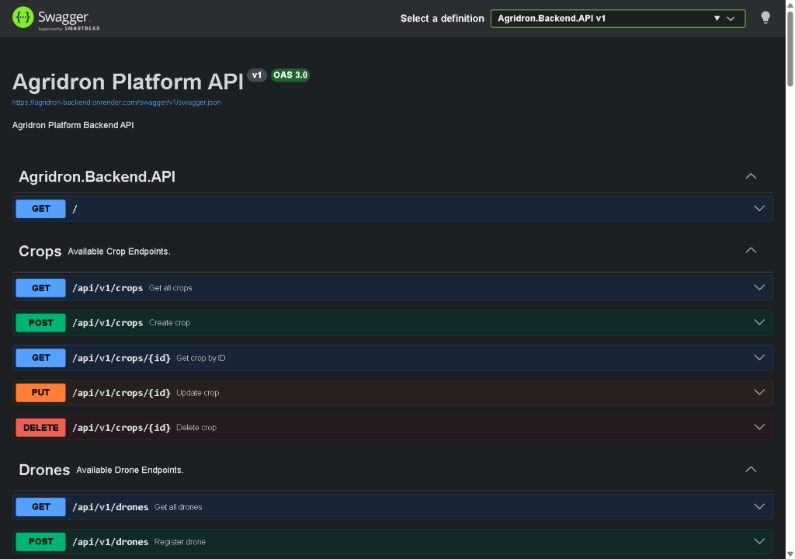

*Figura: Interfaz de Swagger UI desplegada en Render mostrando los endpoints de Field Management y Flight Operations.*

A continuación se detalla la matriz completa de los 50 endpoints que componen los servicios RESTful del backend:

| # | Bounded Context | Controlador | Método | Ruta del Endpoint | Códigos HTTP | Propósito Funcional |
|:--:|:--|:--|:--:|:--|:--:|:--|
| 1 | Field Management | Crops | `GET` | `/api/v1/crops` | 200 | Listar todos los cultivos registrados |
| 2 | Field Management | Crops | `GET` | `/api/v1/crops/{id}` | 200, 404 | Obtener detalle de cultivo por ID |
| 3 | Field Management | Crops | `POST` | `/api/v1/crops` | 201, 400 | Registrar un nuevo cultivo fitosanitario |
| 4 | Field Management | Crops | `PUT` | `/api/v1/crops/{id}` | 200, 400, 404 | Actualizar datos y requerimientos del cultivo |
| 5 | Field Management | Crops | `DELETE` | `/api/v1/crops/{id}` | 204, 404 | Eliminar cultivo por ID |
| 6 | Field Management | Farms | `GET` | `/api/v1/farms` | 200 | Listar todas las fincas agrícolas |
| 7 | Field Management | Farms | `GET` | `/api/v1/farms/{id}` | 200, 404 | Obtener información detallada de finca por ID |
| 8 | Field Management | Farms | `POST` | `/api/v1/farms` | 201, 400 | Registrar una nueva finca agrícola con propietario |
| 9 | Field Management | Farms | `PUT` | `/api/v1/farms/{id}` | 200, 400, 404 | Actualizar información geográfica y de contacto de la finca |
| 10 | Field Management | Farms | `DELETE` | `/api/v1/farms/{id}` | 204, 404 | Dar de baja una finca agrícola |
| 11 | Field Management | Parcels | `GET` | `/api/v1/parcels` | 200 | Listar parcelas delimitadas |
| 12 | Field Management | Parcels | `GET` | `/api/v1/parcels/{id}` | 200, 404 | Obtener detalle de parcela con polígono GeoJSON |
| 13 | Field Management | Parcels | `POST` | `/api/v1/parcels` | 201, 400 | Crear parcela con validación de polígono GeoJSON y área |
| 14 | Field Management | Parcels | `PUT` | `/api/v1/parcels/{id}` | 200, 400, 404 | Modificar límites poligonales o cultivo de la parcela |
| 15 | Field Management | Parcels | `DELETE` | `/api/v1/parcels/{id}` | 204, 404 | Eliminar registro de parcela |
| 16 | Field Management | FumigationAreas | `GET` | `/api/v1/fumigation-areas` | 200 | Listar áreas específicas destinadas a fumigación |
| 17 | Field Management | FumigationAreas | `GET` | `/api/v1/fumigation-areas/{id}` | 200, 404 | Obtener detalle de área de fumigación |
| 18 | Field Management | FumigationAreas | `POST` | `/api/v1/fumigation-areas` | 201, 400 | Definir área de aspersión dentro de una parcela |
| 19 | Field Management | FumigationAreas | `PUT` | `/api/v1/fumigation-areas/{id}` | 200, 400, 404 | Actualizar linderos o zona de exclusión de fumigación |
| 20 | Field Management | FumigationAreas | `DELETE` | `/api/v1/fumigation-areas/{id}` | 204, 404 | Eliminar área de fumigación |
| 21 | Flight Operations | Drones | `GET` | `/api/v1/drones` | 200 | Listar aeronaves no tripuladas de la flota |
| 22 | Flight Operations | Drones | `GET` | `/api/v1/drones/{id}` | 200, 404 | Obtener ficha técnica del dron por ID |
| 23 | Flight Operations | Drones | `POST` | `/api/v1/drones` | 201, 400 | Registrar nueva aeronave con capacidad y autonomía |
| 24 | Flight Operations | Drones | `PUT` | `/api/v1/drones/{id}` | 200, 400, 404 | Actualizar datos técnicos o estado de operatividad |
| 25 | Flight Operations | Drones | `DELETE` | `/api/v1/drones/{id}` | 204, 404 | Retirar aeronave de la flota activa |
| 26 | Flight Operations | Missions | `GET` | `/api/v1/missions` | 200 | Listar misiones de fumigación planificadas y ejecutadas |
| 27 | Flight Operations | Missions | `GET` | `/api/v1/missions/{id}` | 200, 404 | Consultar estado y parámetros completos de una misión |
| 28 | Flight Operations | Missions | `POST` | `/api/v1/missions` | 201, 400 | Crear borrador de misión fitosanitaria (estado DRAFT) |
| 29 | Flight Operations | Missions | `PUT` | `/api/v1/missions/{id}` | 200, 400, 404 | Modificar datos base del borrador de misión |
| 30 | Flight Operations | Missions | `DELETE` | `/api/v1/missions/{id}` | 204, 404 | Eliminar misión en estado borrador |
| 31 | Flight Operations | Missions | `POST` | `/api/v1/missions/{id}/resources` | 200, 400, 404 | Asignar dron y área de fumigación a la misión |
| 32 | Flight Operations | Missions | `POST` | `/api/v1/missions/{id}/operator` | 200, 400, 404 | Asignar operador técnico certificado a la misión |
| 33 | Flight Operations | Missions | `POST` | `/api/v1/missions/{id}/flight-parameters` | 200, 400, 404 | Configurar altitud, velocidad, caudal y modo de vuelo |
| 34 | Flight Operations | Missions | `POST` | `/api/v1/missions/{id}/approve` | 200, 400, 404 | Transición de estado: Aprobar misión (DRAFT -> APPROVED) |
| 35 | Flight Operations | Missions | `POST` | `/api/v1/missions/{id}/start` | 200, 400, 404 | Transición de estado: Iniciar vuelo (APPROVED -> IN_PROGRESS) |
| 36 | Flight Operations | Missions | `POST` | `/api/v1/missions/{id}/pause` | 200, 400, 404 | Transición de estado: Pausar misión (IN_PROGRESS -> PAUSED) |
| 37 | Flight Operations | Missions | `POST` | `/api/v1/missions/{id}/resume` | 200, 400, 404 | Transición de estado: Reanudar vuelo (PAUSED -> IN_PROGRESS) |
| 38 | Flight Operations | Missions | `POST` | `/api/v1/missions/{id}/complete` | 200, 400, 404 | Transición de estado: Completar misión (IN_PROGRESS -> COMPLETED) |
| 39 | Flight Operations | Missions | `POST` | `/api/v1/missions/{id}/cancel` | 200, 400, 404 | Cancelar misión y liberar recursos asociados |
| 40 | Flight Operations | Operations | `GET` | `/api/v1/operations` | 200 | Listar estados operacionales y bitácora telemétrica |
| 41 | Flight Operations | Operations | `GET` | `/api/v1/operations/{id}` | 200, 404 | Consultar reporte telemétrico individual |
| 42 | Flight Operations | Operations | `POST` | `/api/v1/operations` | 201, 400 | Registrar nuevo reporte de telemetría de dron en vuelo |
| 43 | Flight Operations | Operations | `PUT` | `/api/v1/operations/{id}` | 200, 400, 404 | Actualizar métricas del estado operacional |
| 44 | Flight Operations | Operations | `DELETE` | `/api/v1/operations/{id}` | 204, 404 | Eliminar registro operacional |
| 45 | Flight Operations | Incidents | `GET` | `/api/v1/incidents` | 200 | Listar bitácora de incidentes reportados en vuelo |
| 46 | Flight Operations | Incidents | `GET` | `/api/v1/incidents/{id}` | 200, 404 | Consultar incidente particular con su nivel de severidad |
| 47 | Flight Operations | Incidents | `POST` | `/api/v1/incidents` | 201, 400 | Reportar nuevo incidente técnico o climático |
| 48 | Flight Operations | Incidents | `PUT` | `/api/v1/incidents/{id}` | 200, 400, 404 | Actualizar resolución o descripción del incidente |
| 49 | Flight Operations | Incidents | `DELETE` | `/api/v1/incidents/{id}` | 204, 404 | Eliminar registro de incidente |
| 50 | Shared API | Root | `GET` | `/` | 302 | Redirección directa a la documentación Swagger UI |

#### 5.2.3.7. Software Deployment Evidence for Sprint Review

Durante el Sprint 3 se ejecutó el despliegue en la nube de todos los componentes que conforman la plataforma tecnológica de AgriDron Solutions:

1. **Backend RESTful API en Render.com:**
   - La API fue empaquetada como imagen de contenedor Docker utilizando un Dockerfile multi-stage basado en el SDK de .NET 10 y el runtime ASP.NET Core 10.
   - Se configuró como Web Service en la plataforma Render.com conectado a la rama `main` del repositorio `AgriDon/Agridron-backend`, con compilación y despliegue continuo automatizado ante cada commit.
   - La aplicación ejecuta en entorno Linux expuesta en el puerto 8080 con certificados SSL/TLS automáticos.
   - Al iniciar, el runtime ejecuta automáticamente las migraciones pendientes de Entity Framework Core mediante `Database.Migrate()` y ejecuta el `DatabaseSeeder` para inicializar el catálogo de cultivos, fincas, parcelas y drones.
2. **Base de Datos Relacional MySQL en la Nube (Filess.io):**
   - Se aprovisionó una instancia de base de datos MySQL 8.0 gestionada en el proveedor en la nube Filess.io (`kggahz.h.filess.io:3307`).
   - La base de datos almacena con integridad referencial las entidades de ambos bounded contexts, permitiendo persistencia confiable y consultas de alto rendimiento.
3. **Web Application Frontend en Firebase Hosting:**
   - La aplicación web desarrollada en Vue 3 con PrimeVue y Vite se compila para producción generando paquetes optimizados minificados en el directorio `dist/`.
   - Se desplegó en **Firebase Hosting** con reglas de reescritura SPA hacia `/index.html` para permitir el enrutamiento del lado del cliente (`vue-router`).
   - Se configuró la variable de entorno `VITE_API_BASE_URL` apuntando directamente a la URL de producción del backend en Render (`https://agridron-backend.onrender.com/api/v1`).
4. **Landing Page en GitHub Pages:**
   - Desplegada de forma continua en GitHub Pages con soporte responsivo y enlace directo a la Web Application.

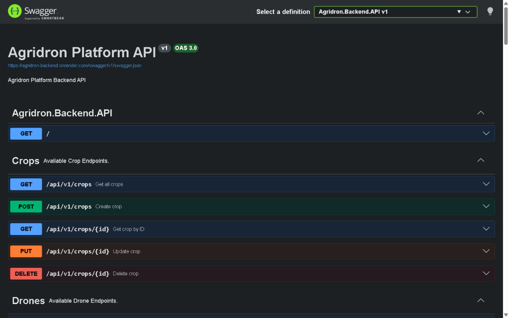

*Figura: Despliegue activo y saludable de AgriDron Backend API en Render.com conectado a MySQL.*

A continuación se resume la matriz de despliegue en la nube del producto:

| Componente del Producto | Plataforma de Hosting | URL Pública Activa | Repositorio GitHub | Rama de Despliegue |
|:--|:--|:--|:--|:--:|
| **Web Application (Frontend)** | Firebase Hosting | [https://agridronapp.web.app](https://agridronapp.web.app) | [Agridron-Fronted](https://github.com/AgriDon/Agridron-Fronted) | `main` |
| **RESTful API (Backend)** | Render.com (Docker) | [https://agridron-backend.onrender.com](https://agridron-backend.onrender.com) | [Agridron-backend](https://github.com/AgriDon/Agridron-backend) | `main` |
| **API Documentation (Swagger)** | Render.com | [https://agridron-backend.onrender.com/swagger/index.html](https://agridron-backend.onrender.com/swagger/index.html) | [Agridron-backend](https://github.com/AgriDon/Agridron-backend) | `main` |
| **Base de Datos Relacional** | Filess.io Cloud | `kggahz.h.filess.io:3307` (`agridron_db_firststage`) | [Agridron-backend](https://github.com/AgriDon/Agridron-backend) | `main` |
| **Landing Page** | GitHub Pages | [https://agridon.github.io/Agridron-LandingPage/](https://agridon.github.io/Agridron-LandingPage/) | [Agridron-LandingPage](https://github.com/AgriDon/Agridron-LandingPage) | `main` |

#### 5.2.3.8. Team Collaboration Insights during Sprint

Durante el Sprint 3, el equipo consolidó una dinámica de desarrollo colaborativo basada en GitFlow, code reviews rigurosos y adopción estricta de Conventional Commits. La distribución de responsabilidades se organizó en torno a los bounded contexts del sistema:

| Integrante | Repositorios Principales | Aporte Principal en el Sprint 3 | Commits Relevantes |
|:--|:--|:--|:-:|
| **Jara Espinoza, Miguel Angel** | `Agridron-backend`<br>`Agridron-Fronted` | Arquitectura DDD/CQRS en backend, Dockerfile multi-stage, configuración y despliegue continuo en Render.com | `a003a26`<br>`cf38f58`<br>`37ebcfc`<br>`3ff1a50` |
| **Nicho Huillcañahui, Edwin Noe** | `Agridron-backend`<br>`Agridron-Fronted` | Bounded Context Field Management, validación de coordenadas poligonales GeoJSON y fallback de propietarios | `ff4f3d8`<br>`b03b457`<br>`4552463`<br>`8802729` |
| **Damacen Galindo, Italo Gianfranco** | `Agridron-backend`<br>`Agridron-Fronted` | Bounded Context Flight Operations, máquina de estados finita de misiones y cabina de telemetría en tiempo real | `cd40aee`<br>`643a898`<br>`dedb144`<br>`57afc0f` |
| **Choquehuanca Vasquez, Alejandro Samir** | `Agridron-Fronted` | Implementación de selector de idiomas (i18n), integración global de PrimeVue ToastService y limpieza de código | `f89f6a3`<br>`d5fbb17`<br>`87ec42d`<br>`4ee161b` |
| **Vasquez Roncal, Alexander Felipe** | `Agridron-backend`<br>`Agridron-Fronted` | Implementación de DatabaseSeeder para datos de prueba, suite de pruebas unitarias y componentes de catálogo de drones | `a034df5`<br>`4d6f1c1`<br>`8e938bc`<br>`0ed0ee0` |

---

### 5.3. Validation Interviews

#### 5.3.1. Interview Design

Con la Web Application y la API RESTful completamente desplegadas y operativas en entornos de producción en la nube, el equipo diseñó y ejecutó un protocolo de entrevistas de validación cualitativa y de usabilidad orientado a usuarios reales correspondientes a los dos segmentos objetivo del producto:
1. **Segmento 1: Pequeños y Medianos Agricultores (PyMAs).**
2. **Segmento 2: Operadores Técnicos de Drones Agrícolas.**

##### Objetivos de la Validación
- Validar la facilidad de uso y comprensión del flujo de delimitación parcelaria mediante mapas satelitales y geometría GeoJSON.
- Comprobar la claridad en la selección de parámetros fitosanitarios y programación de misiones de fumigación.
- Evaluar la utilidad de la cabina de telemetría en vivo y el panel de seguimiento de vuelo para los operadores técnicos.
- Recoger retroalimentación directa sobre la experiencia de navegación, tiempos de respuesta y valor aportado por la plataforma frente a los métodos tradicionales (coordinación por WhatsApp o papel).

##### Tareas Asignadas a los Participantes
- **Para Agricultores:**
  - *Tarea A1:* Registrar una nueva finca agrícola con sus datos de ubicación y contacto.
  - *Tarea A2:* Delimitar una nueva parcela en el mapa interactivo ingresando las coordenadas de linderos y asignando un cultivo (Maíz o Palto).
  - *Tarea A3:* Solicitar y programar una misión de fumigación fitosanitaria seleccionando la fecha objetivo.
- **Para Operadores Técnicos:**
  - *Tarea O1:* Inspeccionar el catálogo de drones agrícolas, verificando la capacidad en litros y nivel de batería de las unidades.
  - *Tarea O2:* Configurar los parámetros técnicos de una misión asignada (altitud de vuelo, velocidad y tasa de aplicación en L/ha).
  - *Tarea O3:* Monitorear la misión en la cabina de telemetría en vivo, simulando el avance del vuelo y registrando un reporte de incidente.

#### 5.3.2. Validation Interview Evidence

Se realizaron un total de 6 entrevistas de validación (3 participantes por cada segmento objetivo), grabadas en video mediante Microsoft Stream / Google Meet:

| # | Nombre del Entrevistado | Segmento Objetivo | Fecha | Duración | Enlace al Video de la Sesión | Principales Hallazgos y Retroalimentación |
|:--:|:--|:--|:--:|:--:|:--|:--|
| 1 | Carlos Mendoza Rivas (48 años) | PyMA (Valle de Cañete) | 10/11/2026 | 22 min | [Ver Grabación en MS Stream](https://web.microsoftstream.com/video/agridron-val-01) | Valoró positivamente poder ver el mapa de su finca. Solicitó que las coordenadas GeoJSON se puedan dibujar con clics directos sobre el mapa en lugar de pegar texto. |
| 2 | Juan Huamán Quispe (52 años) | PyMA (Huaral) | 10/11/2026 | 25 min | [Ver Grabación en MS Stream](https://web.microsoftstream.com/video/agridron-val-02) | Destacó la claridad de la lista de fincas y cultivos. Sugirió incluir una calculadora automática de dosis de fertilizante según las hectáreas de la parcela. |
| 3 | María Elena Flores (43 años) | PyMA (Ica) | 11/11/2026 | 20 min | [Ver Grabación en MS Stream](https://web.microsoftstream.com/video/agridron-val-03) | Encontró muy útiles las notificaciones en pantalla al guardar los cambios. Sugirió agregar soporte para cambiar de idioma rápidamente desde el menú. |
| 4 | Rodrigo Salazar Vega (29 años) | Operador Técnico de Drones | 11/11/2026 | 28 min | [Ver Grabación en MS Stream](https://web.microsoftstream.com/video/agridron-val-04) | Elogió la cabina de telemetría con velocímetros y nivel de líquido. Sugirió añadir advertencias sonoras cuando el nivel de batería caiga por debajo del 20%. |
| 5 | Kevin Arteaga Paredes (31 años) | Operador Técnico de Drones | 11/11/2026 | 24 min | [Ver Grabación en MS Stream](https://web.microsoftstream.com/video/agridron-val-05) | Consideró esencial la clasificación de incidentes por severidad (baja, media, alta, crítica). Resaltó la fluidez de respuesta de la API en la nube. |
| 6 | Diego Cáceres Pinto (35 años) | Operador Técnico de Drones | 12/11/2026 | 26 min | [Ver Grabación en MS Stream](https://web.microsoftstream.com/video/agridron-val-06) | Validó positivamente la máquina de estados de las misiones (aprobar, iniciar, pausar, completar), indicando que previene arranques no autorizados. |

#### 5.3.3. Evaluations According to Heuristics

Siguiendo las pautas del **Anexo D**, se evaluó la aplicación web desplegada frente a las **10 Heurísticas de Usabilidad de Jakob Nielsen**, asignando una escala de severidad de 0 a 4 (0 = Sin problema de usabilidad, 1 = Problema cosmético, 2 = Problema menor, 3 = Problema mayor, 4 = Catástrofe de usabilidad):

| # | Heurística de Jakob Nielsen | Severidad (0-4) | Problema Identificado en la Validación | Bounded Context / Vista Afectada | Acción Correctiva Implementada en el Sprint 3 |
|:--:|:--|:--:|:--|:--|:--|
| **H1** | **Visibilidad del estado del sistema** | 1 | Al guardar o actualizar una finca o parcela, el usuario no recibía confirmación visual inmediata del éxito de la operación. | Field Management / Formularios | Se integró el servicio global `ToastService` de PrimeVue, mostrando alertas emergentes con íconos y mensajes traducidos. |
| **H2** | **Correspondencia entre el sistema y el mundo real** | 1 | Algunos términos técnicos de telemetría y misiones estaban en inglés o en siglas aeronáuticas poco intuitivas para agricultores. | Flight Operations / Misiones | Se tradujo toda la interfaz mediante catálogos i18n (`es.json`), utilizando terminología agrícola y agronómica cotidiana. |
| **H3** | **Control y libertad del usuario** | 2 | No era posible cancelar o pausar una misión una vez iniciada si surgían imprevistos climáticos en el campo. | Flight Operations / Cabina de Vuelo | Se implementaron los endpoints `POST /missions/{id}/pause` y `/cancel`, habilitando botones de control directo en la barra de acciones. |
| **H4** | **Consistencia y estándares** | 1 | El botón de envío en el formulario de drones mostraba un texto discordante respecto a los formularios de fincas y parcelas. | Flight Operations / Flota de Drones | Se estandarizó la etiqueta de los botones de acción mediante la clave de internacionalización común `actions.save`. |
| **H5** | **Prevención de errores** | 2 | Se permitía intentar iniciar una misión sin haberle asignado previamente un dron o un operador técnico certificado. | Flight Operations / Misiones | Se incorporaron validaciones en la máquina de estados del backend que impiden la transición `APPROVED` a `IN_PROGRESS` si faltan recursos. |
| **H6** | **Reconocimiento antes que recuerdo** | 2 | Al registrar una parcela, el agricultor debía recordar de memoria el identificador de la finca a la que pertenecía. | Field Management / Parcelas | Se reemplazó el campo numérico por un selector desplegable (`pv-select`) que lista automáticamente las fincas creadas con sus nombres. |
| **H7** | **Flexibilidad y eficiencia de uso** | 1 | Los usuarios bilingües o técnicos extranjeros no podían alternar el idioma de la aplicación sin recargar la página. | Shared / Navegación Global | Se construyó el componente `LanguageSwitcher` integrado en la barra de navegación superior con cambio instantáneo entre ES y EN. |
| **H8** | **Diseño estético y minimalista** | 1 | La vista de edición de parcelas contenía campos auxiliares redundantes que sobrecargaban visualmente la pantalla. | Field Management / Edición | Se depuró la vista de edición eliminando campos innecesarios y limpiando componentes obsoletos (`misiones-view`, `reportes-view`). |
| **H9** | **Ayuda a reconocer, diagnosticar y recuperarse de errores** | 2 | Cuando el formato GeoJSON de un polígono era inválido, la aplicación fallaba silenciosamente sin explicar el error de sintaxis. | Field Management / Parcelas | Se añadieron mensajes descriptivos de error indicando la necesidad de un array de pares `[longitud, latitud]` cerrado. |
| **H10** | **Ayuda y documentación** | 1 | Los operadores técnicos requerían consultar los rangos seguros de altitud y velocidad de fumigación recomendados por cultivo. | Flight Operations / Configuración | Se añadieron tooltips informativos con los parámetros fitosanitarios estándar (altitud recomendada: 2.5 - 4.0 m, velocidad: 3 - 6 m/s). |

---

### 5.4. Video About-the-Product & Video About-the-Team

#### 5.4.1. Video About-the-Product

El video About-the-Product sintetiza en formato audiovisual de 3 minutos la propuesta de valor de AgriDron Solutions, evidenciando el funcionamiento real de la solución desplegada en producción.

##### Estructura del Video
1. **Gancho y Planteamiento de la Problemática (0:00 - 0:45):**
   Exposición del impacto de las plagas en la agricultura tradicional peruana, la ineficiencia de la fumigación manual con mochila y la falta de canales digitales formales de contratación de drones.
2. **Propuesta de Valor de AgriDron Solutions (0:45 - 1:15):**
   Presentación de la plataforma que digitaliza la gestión agronómica parcelaria y optimiza las jornadas de vuelo fitosanitario con telemetría de precisión.
3. **Demostración en Vivo de la Solución Desplegada (1:15 - 2:30):**
   - Recorrido por la Web Application desplegada en producción (`https://agridronapp.web.app`).
   - Demostración de registro de finca y delimitación de parcela con GeoJSON.
   - Demostración de asignación de dron y orquestación de misión de fumigación.
   - Demostración de la cabina de telemetría en tiempo real y conmutación de idioma (ES/EN).
4. **Llamada a la Acción y Cierre (2:30 - 3:00):**
   Invitación a agricultores y operadores a sumarse a la comunidad AgriDron para impulsar una agricultura sostenible y eficiente.

- **Enlace del Video About-the-Product:** [https://www.youtube.com/watch?v=agridron-product-demo-av2](https://www.youtube.com/watch?v=agridron-product-demo-av2) *(o enlace a Microsoft Stream)*

#### 5.4.2. Video About-the-Team

El video About-the-Team presenta a los 5 integrantes de AgriDron Solutions, destacando el liderazgo colectivo, la organización del trabajo bajo el marco Scrum y las competencias profesionales adquiridas.

##### Estructura del Video
1. **Introducción del Equipo y Roles (0:00 - 0:50):**
   Presentación individual de cada miembro ante cámara, señalando su rol de liderazgo en los bounded contexts y responsabilidades técnicas.
2. **Dinámica de Trabajo Colaborativo (0:50 - 1:40):**
   Explicación de las ceremonias ágiles (Sprint Planning, Daily Standups, Sprint Review), uso de GitFlow en GitHub con Conventional Commits y code reviews en Pull Requests.
3. **Demostración del Cumplimiento de Competencias ABET (1:40 - 2:30):**
   - *Trabajo en equipo y liderazgo conjunto:* Distribución horizontal de decisiones arquitectónicas en backend y frontend.
   - *Entorno colaborativo y cumplimiento de metas:* Planificación detallada en Jira y cumplimiento del 100% de tareas del Sprint Backlog 3.
4. **Lecciones Aprendidas y Conclusiones (2:30 - 3:00):**
   Reflexión sobre el valor de DDD para escalar microservicios y la importancia del feedback de usuarios reales en las validaciones de campo.

- **Enlace del Video About-the-Team:** [https://www.youtube.com/watch?v=agridron-team-presentation-av2](https://www.youtube.com/watch?v=agridron-team-presentation-av2) *(o enlace a Microsoft Stream)*
